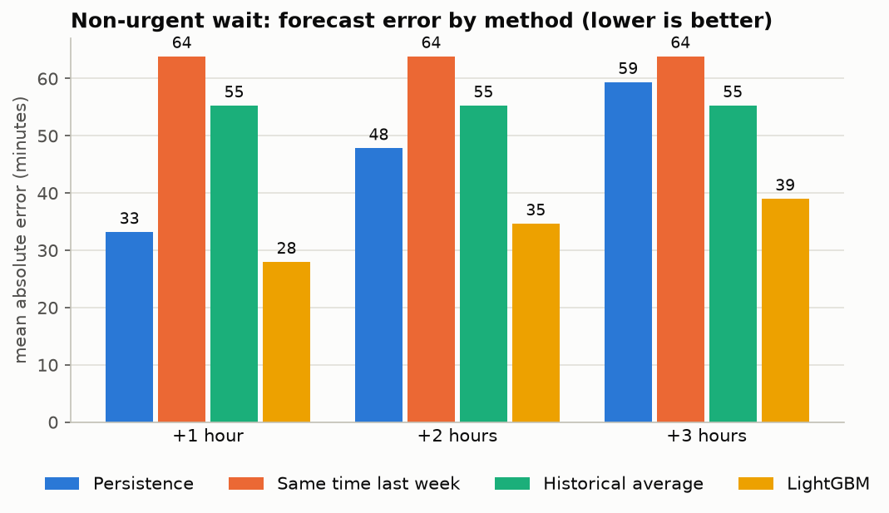

# A&E Compass HK.

**Where in Hong Kong would a non-urgent patient be seen soonest?** The nearest public A&E is often not the
fastest. This project combines A&E waiting-time data, a forecasting model and travel times to estimate
*travel time + predicted wait on arrival* for every public A&E.

> **Not medical advice. Not an official Hospital Authority service.** For non-life-threatening situations only.
> In an emergency call **999**.

## Status

Work in progress. Forecasting is evaluated; the recommender and the agent are not built yet.

| Milestone | State |
|---|---|
| M0: data sources verified, collector running, history downloaded | Done |
| M1: clean dataset, exploratory analysis, baselines | Done |
| M2: forecasting model with intervals | Done |
| M3: travel times, recommendation engine, basic agent with safety eval | Not started |

## Results so far: forecasting

Mean absolute error in minutes when forecasting HA's published **non-urgent (triage IV & V) median wait**.
Walk-forward validation over 24 two-week test blocks (Dec 2025 – Nov 2026, 18 hospitals, 1.69 million
forecasts). The typical wait over the same rows is 165 minutes.
Source: [`evals/reports/forecast.md`](evals/reports/forecast.md).

| Forecast horizon | Persistence ("stays as now") | Same time last week | Historical average | **LightGBM** | vs best baseline |
|---|---|---|---|---|---|
| +1 hour | 33.2 | 63.9 | 55.3 | **28.0** | −15.7% |
| +2 hours | 47.8 | 63.9 | 55.3 | **34.6** | −27.5% |
| +3 hours | 59.4 | 63.9 | 55.3 | **39.0** | −29.5% |

- The model beats all three baselines in **24 of 24** test blocks at every horizon, and at every hospital.
- **80% prediction intervals** contained the actual value 79.5–79.8% of the time (worst single block: 75.5%).
  They are wide: about ±45 minutes at +1h and ±62 minutes at +3h.
- For the triage III (urgent) median wait the model is 8–12% better than the best baseline.
- Weather features did not help and were removed. Details and ablations are in the report.



Caveats: 13 months of data, so no repeated seasons; hyperparameters were not tuned; and the target is HA's
published estimate, rounded to the half hour, not a measured wait.

## What exists today

- `src/aecompass/collect/`: collectors for A&E snapshots (15-minute data, about 13 months of history) and
  Hong Kong Observatory weather.
- `.github/workflows/collect.yml`: hourly collection into the GitHub Release tagged `data`, with a freshness
  check that opens an issue on failure.
- `src/aecompass/clean/`: validates every snapshot and converts all waits to minutes.
- `src/aecompass/forecast/`: walk-forward splits, the three baselines, features, the LightGBM model and
  conformal intervals.
- `evals/`: scripts that generate every number and chart in `evals/reports/`.
- `docs/data_sources.md`: what each data source really returns, checked by hand.
- `DECISIONS.md`: why each design choice was made.

## Run it

```bash
python -m venv .venv
.venv/Scripts/activate            # macOS/Linux: source .venv/bin/activate
pip install -e ".[dev]"
pytest
python -m aecompass.collect.aed --days-back 3        # recent snapshots
python -m aecompass.collect.aed --start 2025-10-14   # full history (about 2 hours, resumable)
python -m aecompass.collect.freshness
python -m aecompass.clean.build                      # raw -> data/clean/aed_waits.parquet + quality report
python evals/run_eda.py                              # charts and findings
python evals/run_baselines.py                        # baseline table
python evals/run_forecast.py --ablations             # model vs baselines, intervals (about 20 minutes)
```

Data lands in `data/raw/`, which is not committed.

## A note on what is being forecast

The waiting times are the Hospital Authority's *published estimates*, not measured waits of individual
patients. Every result in this project is about predicting those published figures.

## Data sources and credits

Hospital Authority (A&E waiting times) via data.gov.hk; Transport Department; MTR Corporation;
Hong Kong Observatory; Open-Meteo; 1823; Lands Department; Census and Statistics Department.
Details in `docs/data_sources.md`. Used under the data.gov.hk Terms and Conditions.
