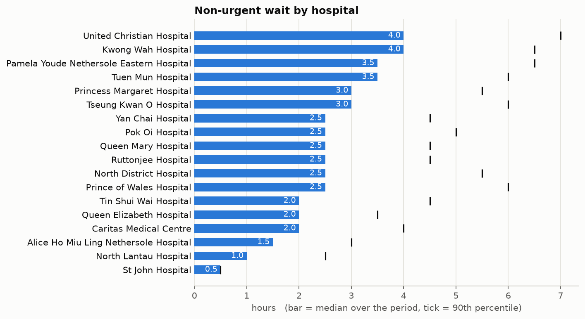
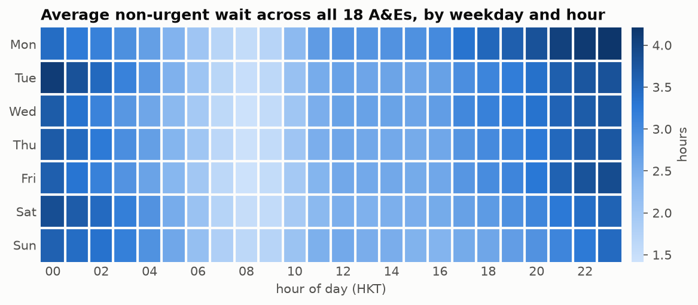
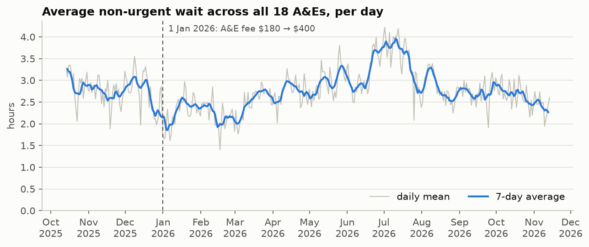

# Exploratory analysis

Generated by `python evals/run_eda.py`. Do not edit by hand.

Period: 14 Oct 2025 to 14 Nov 2026. 18 hospitals. 37,642 complete 15-minute slots.
'Non-urgent wait' means HA's published median wait for triage IV & V (`t45_p50_min`).
These are HA's published estimates, not measured patient waits.

## 1. Hospitals differ a lot

- Shortest median: **St John Hospital** (0.5 h). Longest: **United Christian Hospital** (4.0 h).
- At a typical moment the gap between the longest and shortest non-urgent wait in the city is **5.0 hours** (median; 10th–90th percentile 3.0–8.0 h). This gap is the reason a recommender could help at all.

## 2. There is a weekly and daily rhythm

- City-wide average peaks on **Mon around 23:00** (4.2 h) and is lowest on **Fri around 08:00** (1.4 h).

## 3. Level over time

- Mean of daily city-wide averages before 1 Jan 2026: **2.78 h** (79 days); from 1 Jan 2026: **2.75 h** (318 days).
- This is a description, not a causal estimate: the 'before' window is short and covers a different season.

## 4. How much does the wait move in 1–3 hours?

| Horizon | Share of cases unchanged | Mean absolute change (min) | 90th percentile change (min) |
|---|---|---|---|
| +1h | 31% | 33 | 60 |
| +2h | 23% | 48 | 120 |
| +3h | 19% | 60 | 120 |

- 100.0% of non-urgent values are exact multiples of 30 minutes, as expected from HA's rounding to the nearest half hour. The target is a step function, not a smooth curve.
- Triage III median wait for comparison: mean 23 min, 90th percentile 35 min.

## 5. 'Managing multiple resuscitation cases'

- Appears in 2.79% of rows. Most often at **United Christian Hospital** (24.4% of its rows); least often at **St John Hospital** (0.0%).
