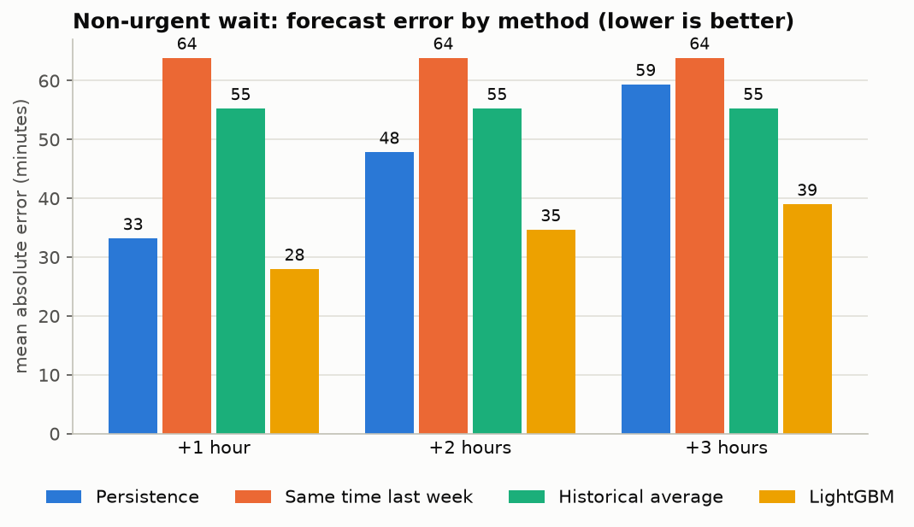
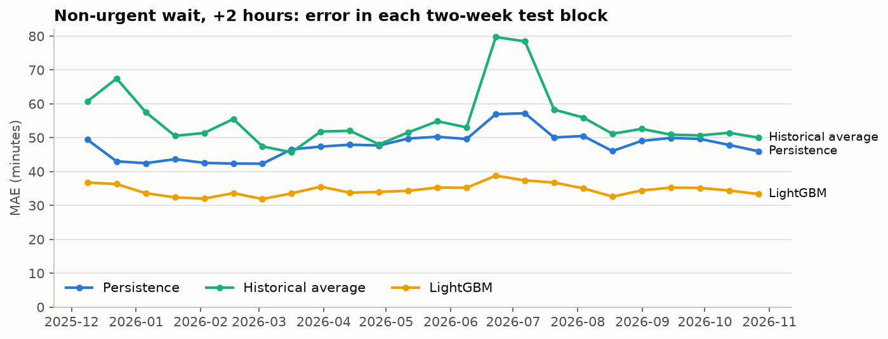

# Forecast results (walk-forward)

Generated by `python evals/run_forecast.py`. Do not edit by hand.

The values being predicted are the Hospital Authority's **published estimates**, not measured
patient waits. Errors are mean absolute error (MAE) in **minutes**; lower is better.

- Test period: 09 Dec 2025 to 09 Nov 2026, 24 two-week blocks, 18 hospitals.
- For each block the model is trained only on forecasts whose answer was already known before the block started, then scored on the block. Baselines and model are scored on identical rows.
- One LightGBM model per target and horizon, shared across hospitals, no weather features. Fixed hyperparameters, not tuned on these test blocks. Trained on forecasts made on the hour and half hour; tested on all.
- Report rebuilt from the saved forecasts (`--report-only`); the models were not retrained.

## `t45_p50_min`: Triage IV & V (semi-/non-urgent), median wait

| horizon_h | persistence | seasonal_naive | historical_mean | model | vs persistence | vs best baseline | blocks where model beats every baseline |
|---|---|---|---|---|---|---|---|
| 1 | 33.2 | 63.9 | 55.3 | 28.0 | -15.7% | -15.7% | 24 of 24 |
| 2 | 47.8 | 63.9 | 55.3 | 34.6 | -27.5% | -27.5% | 24 of 24 |
| 3 | 59.4 | 63.9 | 55.3 | 39.0 | -34.3% | -29.5% | 24 of 24 |

Worst single hospital, model vs that hospital's best baseline: +1h -9.0%, +2h -12.3%, +3h -10.7% (negative means the model wins at every hospital).

**80% prediction intervals** (rolling conformal, per hospital; blocks 2 onward, 1,623,798 forecasts). Target coverage is 80%.

| horizon_h | coverage | mean width (min) | lowest block | highest block | lowest hospital |
|---|---|---|---|---|---|
| 1 | 79.8% | 89.6 | 76.2% | 82.0% | 79.4% |
| 2 | 79.6% | 110.9 | 76.1% | 81.8% | 79.3% |
| 3 | 79.5% | 124.6 | 75.5% | 82.2% | 78.9% |

## `t3_p50_min`: Triage III (urgent), median wait

| horizon_h | persistence | seasonal_naive | historical_mean | model | vs persistence | vs best baseline | blocks where model beats every baseline |
|---|---|---|---|---|---|---|---|
| 1 | 6.3 | 6.9 | 5.6 | 4.9 | -22.6% | -12.1% | 24 of 24 |
| 2 | 7.0 | 6.9 | 5.6 | 5.0 | -27.4% | -9.3% | 24 of 24 |
| 3 | 7.3 | 6.9 | 5.6 | 5.1 | -29.9% | -8.2% | 24 of 24 |

Worst single hospital, model vs that hospital's best baseline: +1h -7.5%, +2h -5.3%, +3h -3.8% (negative means the model wins at every hospital).

**80% prediction intervals** (rolling conformal, per hospital; blocks 2 onward, 1,623,798 forecasts). Target coverage is 80%.

| horizon_h | coverage | mean width (min) | lowest block | highest block | lowest hospital |
|---|---|---|---|---|---|
| 1 | 79.3% | 15.4 | 75.0% | 84.9% | 78.5% |
| 2 | 79.3% | 15.9 | 74.6% | 84.2% | 78.4% |
| 3 | 79.2% | 16.1 | 74.4% | 83.7% | 78.3% |

## Ablations (non-urgent target)

Same folds and rows. `model_with_weather` adds four weather features (temperature, rain, rain over 3 hours, humidity). `model_last_120d` trains only on the most recent 120 days instead of all history.

| horizon_h | persistence | model | model_with_weather | model_last_120d |
|---|---|---|---|---|
| 1 | 33.17 | 27.96 | 27.99 | 28.10 |
| 2 | 47.81 | 34.65 | 34.70 | 34.86 |
| 3 | 59.35 | 38.98 | 39.07 | 39.21 |

Blocks 12 onward only (from mid-2026, where a 120-day window no longer contains any data from before the 1 Jan 2026 fee change):

| horizon_h | model | model_last_120d |
|---|---|---|
| 1 | 28.51 | 28.71 |
| 2 | 35.24 | 35.54 |
| 3 | 39.65 | 39.98 |

## What the model uses

Share of total split gain, non-urgent target at +2h, model from the last block. Gain shows what the trees split on, not causal importance, and correlated features share credit arbitrarily.

| feature | share of gain |
|---|---|
| target_hour | 15.5% |
| target_hour_sin | 10.2% |
| hospital | 10.0% |
| y_now | 9.2% |
| now_vs_city | 8.3% |
| now_vs_mean_24h | 7.0% |
| target_time_mean_4w | 5.4% |
| move_same_window_last_week | 5.2% |
| move_same_window_yesterday | 4.9% |
| target_hour_cos | 3.5% |
| t45_p95_min_now | 3.4% |
| now_vs_usual_now | 2.4% |

Per-block and per-hospital numbers: `forecast_by_fold.csv`, `forecast_by_hospital.csv`.
