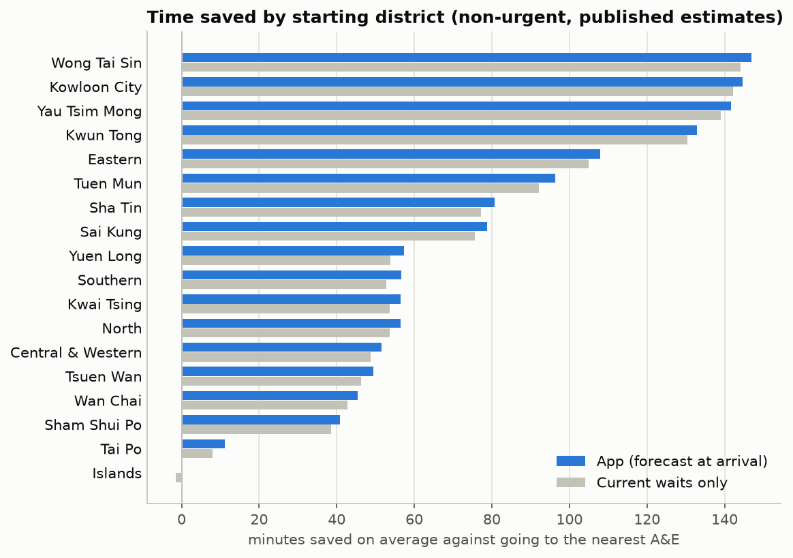

# Recommendation results: hindsight regret

Generated by `python evals/run_regret.py`. Do not edit by hand.

**Read this first.** "Time to be seen" here is an estimated travel time plus the Hospital Authority's **published estimate** at the arrival time. It is not a measured patient wait, and the travel times are straight-line approximations that have not yet been checked against a journey planner. The result shows what the published numbers imply, not what patients experienced.

- Period: 09 Dec 2025 to 09 Nov 2026; every 15-minute moment where all 18 A&Es had out-of-sample forecasts and published outcomes (30,623 of 30,740 moments).
- Starting points: 18, one landmark per district (`evals/regret_origins.csv`), equally weighted. 544,563 replayed decisions.
- Non-urgent target (Triage IV & V median wait). Forecasts are the walk-forward ones from `evals/reports/forecast.md`, so no decision uses information from its own future.
- Travel model: 10 min overhead + straight-line km x 1.4 / 20 km/h, plus 10 min to cross the harbour and 10 min for the Lantau link. First guesses, not fitted.
- Ferry-only trips are not offered: St John Hospital (Cheung Chau) is never suggested to these 18 starting points, so 17 A&Es compete.

## Headline

Following the app's top pick instead of going to the nearest A&E gives a time to be seen that is **75 minutes shorter on average** (median 50).

| method | mean time to be seen (min) | saved vs nearest (min) | regret vs oracle (min) |
|---|---|---|---|
| nearest | 198.3 | 0.0 | 86.0 |
| current_waits | 125.9 | 72.3 | 13.7 |
| app | 123.0 | 75.3 | 10.7 |
| oracle | 112.2 | 86.0 | 0.0 |

`current_waits` is the same recommender without forecasting. `oracle` knows the future and marks the most that any method could save.

The app's pick is 36 minutes away on average; the nearest A&E is 16. The saving is a longer trip traded for a shorter wait.

## How much this depends on the travel estimate

The same replay with every trip made 1.5 and 2 times as long:

| travel times | nearest | app | saved by app | saved by current_waits | app's mean trip (min) | nearest's mean trip (min) |
|---|---|---|---|---|---|---|
| x1 | 198.3 | 123.0 | 75.3 | 72.3 | 36.5 | 16.4 |
| x1.5 | 206.4 | 140.9 | 65.6 | 61.8 | 46.1 | 24.7 |
| x2 | 214.7 | 156.5 | 58.2 | 54.2 | 55.2 | 32.9 |

## How the saving is distributed

- The app picks a different A&E from the nearest in 73.5% of decisions. In the rest the saving is zero by definition.
- When it picks differently: better than nearest 90.0%, worse 10.0%, the same 0.0%; mean saving 102 minutes.
- Over all decisions the app ends up worse than nearest in 7.3%, by 23 minutes on average when it does.
- Percentiles of minutes saved: 10th 0, 25th 0, median 50, 75th 124, 90th 208.
- By calendar day, the average saving ranged from 22 to 145 minutes and was positive on 100.0% of 336 days.
- By two-week block, it ranged from 43 to 114 minutes.

## By starting district

| district | nearest | current_waits | app | oracle | saved | app picks another A&E |
|---|---|---|---|---|---|---|
| Wong Tai Sin | 268.1 | 123.9 | 121.1 | 109.4 | 147.0 | 97% |
| Kowloon City | 262.6 | 120.5 | 117.9 | 106.7 | 144.7 | 96% |
| Yau Tsim Mong | 255.2 | 116.2 | 113.5 | 103.4 | 141.7 | 95% |
| Kwun Tong | 261.0 | 130.5 | 128.1 | 115.4 | 132.9 | 96% |
| Eastern | 239.3 | 134.4 | 131.3 | 119.2 | 108.0 | 86% |
| Tuen Mun | 230.3 | 138.1 | 134.0 | 123.0 | 96.3 | 84% |
| Sha Tin | 205.7 | 128.6 | 124.9 | 112.5 | 80.8 | 78% |
| Sai Kung | 218.2 | 142.5 | 139.4 | 125.9 | 78.7 | 78% |
| Yuen Long | 182.3 | 128.4 | 125.0 | 114.7 | 57.3 | 72% |
| Southern | 190.5 | 137.7 | 133.8 | 122.5 | 56.7 | 77% |
| Kwai Tsing | 177.5 | 123.9 | 121.1 | 108.2 | 56.5 | 78% |
| North | 180.5 | 127.0 | 124.1 | 115.1 | 56.4 | 60% |
| Central & Western | 174.3 | 125.5 | 122.7 | 112.2 | 51.6 | 74% |
| Tsuen Wan | 173.8 | 127.6 | 124.4 | 110.7 | 49.4 | 73% |
| Wan Chai | 167.5 | 124.8 | 122.0 | 111.9 | 45.4 | 70% |
| Sham Shui Po | 154.9 | 116.4 | 114.1 | 104.0 | 40.8 | 71% |
| Tai Po | 128.1 | 120.1 | 116.8 | 108.3 | 11.2 | 36% |
| Islands | 99.1 | 100.6 | 98.9 | 97.1 | 0.3 | 3% |

Columns are mean minutes to be seen under each method; `saved` is nearest minus app.

## Does the band at the arrival time hold?

The recommender stretches the 80% forecast band to the arrival time (see `recommend/engine.py`). Across 8,886,104 hospital-moments it contained the published value 75.9% of the time (target 80%).

Per-district and per-block numbers: `regret_by_district.csv`, `regret_by_fold.csv`.
